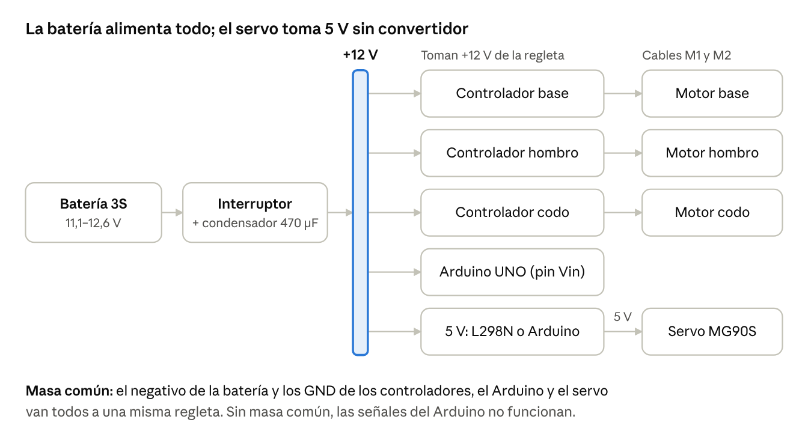
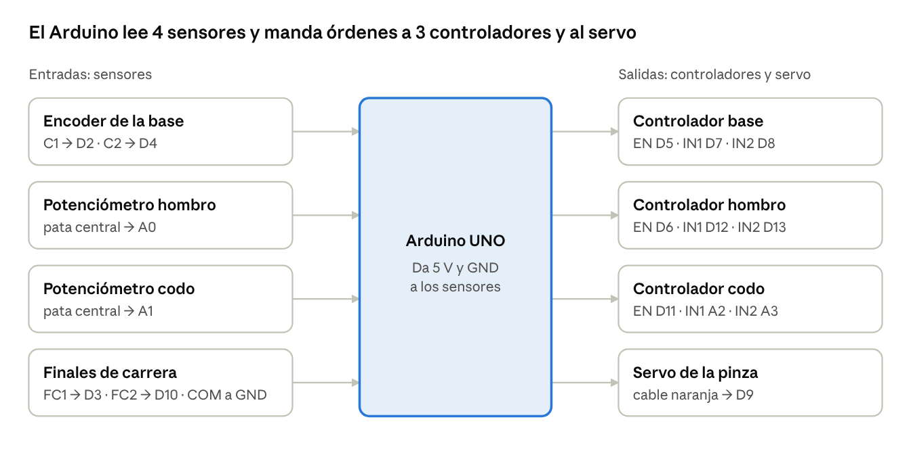

# Guía de cableado del brazo robótico

Actualizada el 12 de noviembre de 2026, tras la tutoría: sin fusible ni convertidor de 5 V, con condensadores, y todo
montado sobre una tabla de aglomerado.

## Esquema general

La batería de 12 V alimenta los 3 controladores de motor y el Arduino. El servo toma 5 V del controlador o del Arduino, sin convertidor aparte. El Arduino no da corriente a los motores: solo lee los sensores y manda órdenes a los controladores.

La corriente de los motores no pasa por el Arduino: va de la regleta a cada controlador y de ahí al motor. El Arduino solo toma 12 V por Vin para alimentarse.

Cada controlador recibe 3 señales del Arduino: una de velocidad (EN) y dos de sentido (IN1, IN2). El detalle de cada conexión está en las secciones de abajo.

## Material

Además de los componentes comprados, para cablear hace falta esto:

| Qué | Cant. | Para qué |
| --- | --- | --- |
| Batería 3S (11,1–12,6 V) | 1 | Alimenta todo |
| Interruptor general (≥ 5 A) | 1 | Cortar la corriente de golpe |
| Condensador electrolítico de 470–1000 µF, ≥ 25 V | 1 | Absorber los picos de corriente de los motores |
| Condensador electrolítico de 470 µF, ≥ 10 V | 1 | Picos de corriente del servo |
| Controlador de motor | 3 | Uno por motor |
| Tabla de aglomerado de unos 40 × 60 cm, 16–19 mm de grosor | 1 | Base de todo el montaje |
| Tirafondos Ø4 × 35 (tabla de 16 mm) o Ø4 × 40 (19 mm) con arandela | 4 | Atornillar la base del brazo a la tabla |
| Tirafondos Ø3 × 12 o separadores adhesivos | 8–12 | Fijar el Arduino y los controladores a la tabla |
| Cable rojo y negro de 0,5–0,75 mm² (20–18 AWG) | 2 m de cada | Batería, controladores y motores |
| Cable fino de 0,14–0,25 mm² (26–24 AWG) o cables dupont | 3 m aprox. | Señales, sensores y servo |
| Alargador de servo (3 hilos) | 1 | Llevar el servo desde la pinza hasta la tabla |
| Resistencias de 10 kΩ | 3 | Mantener los motores parados mientras el Arduino arranca |
| Condensadores de 100 nF | 2 | Quitar ruido a los potenciómetros |
| Regleta o bornes Wago | 2 | Repartir +12 V y masa |
| Bridas, funda espiral o malla | — | Recoger los cables por el brazo |
| Multímetro | 1 | Comprobaciones |

## Montaje sobre la tabla de aglomerado

El brazo, el Arduino y los controladores van atornillados a la misma tabla: así el brazo no vuelca y el cableado queda fijo.

1. **Coloca la base hacia un extremo de la tabla**, con el frente del brazo mirando al lado largo. El brazo llega a unos 37 cm del eje: delante quedan los cubos y detrás la electrónica.
2. **Marca los 4 agujeros** con la base y el suplemento puestos en su sitio (las orejetas tienen agujeros de 4,7 mm). Haz un pretaladro de 2,5 mm para que el aglomerado no se abra.
3. **Atornilla con 4 tirafondos Ø4 y arandela.** Atraviesan 25 mm de plástico (orejeta + suplemento): Ø4 × 35 en una tabla de 16 mm, Ø4 × 40 en una de 19 mm o más. Aprieta en cruz y sin pasarte, para no partir las orejetas.
4. **Saca los cables del motor de la base** por la salida de cables del suplemento antes de apretar.
5. **Fija el Arduino y los 3 controladores detrás de la base**, fuera del giro del brazo, con tirafondos cortos o separadores adhesivos. Deja la batería suelta o con velcro, para poder quitarla y cargarla.

Del brazo solo bajan a la tabla los cables de motores, sensores y servo.

## Alimentación

Todo sale de la batería de 12 V: los motores la toman directa a través de sus controladores y el Arduino por **Vin**. Haz esta parte con la batería **desconectada**.

1. **Batería → interruptor general.** El positivo de la batería pasa por el interruptor. Usa cable de 0,5–0,75 mm².
2. **+12 V a los 3 controladores.** Del interruptor, a una regleta, y de ahí un cable a la entrada de motor de cada controlador (se llama `VM`, `VS`, `12V` o `+` según el modelo).
3. **Condensador de 470–1000 µF (≥ 25 V)** entre la regleta de +12 V y la de masa, cerca de los controladores. Absorbe los picos de corriente cuando arrancan o frenan los motores. **Respeta la polaridad:** la pata de la franja (negativo) va a masa. Al revés, revienta.
4. **+12 V al Arduino.** De la misma regleta, al pin **Vin** del Arduino (o al conector redondo). Acepta 7–12 V; con la batería llena (12,6 V) el regulador de la placa se calienta un poco, es normal.
5. **Masa común.** El negativo de la batería va a una segunda regleta, y a ella llegan el GND de los 3 controladores, un GND del Arduino y la masa del servo. **Sin masa común, las señales PWM no funcionan.**

Reglas:

- **Sin fusible, nada corta un cortocircuito.** El condensador suaviza picos, pero no protege de un corto, y una batería de litio en corto da muchísima corriente. Comprueba con el multímetro que no hay continuidad entre +12 V y masa cada vez que cambies un cable, antes de conectar la batería.
- **El 5 V del Arduino es para los sensores:** encoder de la base y los 2 potenciómetros. Si tu controlador necesita 5 V de lógica (TB6612, BTS7960), también sale de ahí.
- **No unas el 5 V del Arduino con el 5 V que da el L298N** (lo da si tiene puesto el jumper `5V_EN`). Solo se unen las masas.
- Puedes tener el USB conectado a la vez que la batería: el Arduino elige solo de dónde se alimenta.

## Motores y controladores

Cada motor tiene su controlador, y cada controlador recibe 3 cables del Arduino: uno de PWM (velocidad) y dos de sentido. Por defecto el programa usa controladores de tipo L298N (`MODO_EN_IN1_IN2` en `config.h`).

| Motor | PWM → `EN` / `ENA` | Sentido → `IN1` | Sentido → `IN2` |
| --- | --- | --- | --- |
| Base | D5 | D7 | D8 |
| Hombro | D6 | D12 | D13 |
| Codo | D11 | A2 | A3 |

En cada controlador:

1. **Alimentación:** `VM`/`12V` a la regleta de +12 V y `GND` a la regleta de masa.
2. **Motor:** los 2 cables gordos del motor a `OUT1` y `OUT2` (`MOTORA`/`MOTORB` en algunos). En el cable de 6 hilos del JGB37 son los marcados **M1** y **M2** en la placa del encoder; da igual cuál va a cada lado, el sentido se corrige luego con `SENTIDO`.
3. **Lógica:** `EN`, `IN1` e `IN2` a los pines de la tabla. En el L298N, **quita el jumper de `ENA`**: si lo dejas, el motor va siempre a tope y el Arduino no controla la velocidad.
4. **Resistencia de 10 kΩ** entre cada pin de PWM (D5, D6, D11) y GND. Mientras el Arduino arranca sus pines quedan al aire, y sin ella un motor puede dar un tirón al encender o al pulsar reset.

Del hombro y del codo solo se conectan **M1 y M2**: sus encoders no se usan (el ángulo lo da el potenciómetro). Aísla los otros 4 hilos con cinta o termorretráctil.

Si vuestros controladores no son de tipo L298N:

| Controlador | Cómo conectarlo | `MODO_DRIVER` |
| --- | --- | --- |
| L298N | `ENA`→PWM, `IN1`, `IN2` como en la tabla. Quitar jumper `ENA` | `MODO_EN_IN1_IN2` |
| TB6612FNG | `PWMA`→PWM, `AIN1`, `AIN2`. `VCC` y `STBY` al 5 V del Arduino | `MODO_EN_IN1_IN2` |
| BTS7960 (IBT-2) | `R_EN` y `L_EN` juntos→PWM, `RPWM`→IN1, `LPWM`→IN2. `VCC` al 5 V del Arduino | `MODO_EN_IN1_IN2` |
| Pololu G2, Cytron MD10C, VNH5019 | `PWM`→pin de PWM, `DIR`→pin IN1. IN2 sin usar | `MODO_PWM_DIR` |

El L298N pierde unos 2 V internamente: los motores reciben unos 10 V y van algo más lentos que a 12 V. Para este brazo es suficiente.

## Sensores

Los tres tipos de sensor van al 5 V y al GND del Arduino. Ninguno necesita la batería.

### Encoder del motor de la base

La placa del encoder, en la parte trasera del motor, tiene 6 pines con su nombre impreso. Guíate por los nombres y no por los colores, que cambian según el vendedor.

| Pin del encoder | Va a | Nota |
| --- | --- | --- |
| `M1`, `M2` | `OUT1`, `OUT2` del controlador de la base | Los cables del motor |
| `VCC` (o `3.3V`/`5V`) | 5 V del Arduino |  |
| `GND` | GND del Arduino |  |
| `C1` (o `A`) | **D2** | Canal A: el pin con interrupción |
| `C2` (o `B`) | **D4** | Canal B |

Si al girar la base el ángulo va al revés, no cambies cables: se corrige con el comando `INVENC`.

### Potenciómetros del hombro y del codo

Cada potenciómetro tiene 3 patas. Las de los extremos van a 5 V y a GND, y la del medio (el cursor) al pin analógico:

| Potenciómetro | Pata central | Extremos |
| --- | --- | --- |
| Hombro | **A0** | 5 V y GND |
| Codo | **A1** | 5 V y GND |

- No importa qué extremo va a 5 V: el sentido se ajusta al calibrar con `CAL`.
- Pon un **condensador de 100 nF** entre la pata central y GND, lo más cerca posible del Arduino. Los cables son largos y recogen ruido de los motores.
- Suelda las patas y protégelas con termorretráctil: un cursor que se suelta da una lectura de 0 o 1023 y el programa para el brazo (`pot ... sin senal`).

### Finales de carrera de la base

Cada microinterruptor tiene 3 terminales: `COM`, `NO` (normalmente abierto) y `NC` (normalmente cerrado). Usa **`COM` y `NO`**; `NC` queda libre.

| Final de carrera | `COM` | `NO` |
| --- | --- | --- |
| FC1: lado horario, visto desde arriba | GND | **D3** |
| FC2: lado antihorario | GND | **D10** |

No hacen falta resistencias: el programa activa la resistencia interna (pull-up) y lee "pulsado" cuando el pin baja a 0 V. Si en vez de pulsadores sueltos tenéis módulos de 3 pines (`VCC`, `GND`, `OUT`), conecta `OUT` al pin, `VCC` a 5 V y `GND` a GND. Comprueba con `ESTADO` que al pulsarlo `fc=` cambia de 0 a 1.

## Servo de la pinza

El MG90S tiene 3 cables. La señal va al Arduino y los 5 V salen del controlador o del Arduino, sin convertidor aparte.

| Cable del servo | Va a |
| --- | --- |
| Marrón (GND) | Regleta de masa común |
| Rojo (+5 V) | Toma de 5 V (ver la tabla siguiente) |
| Naranja (señal) | **D9** del Arduino |

De dónde sacar los 5 V del servo:

| Toma de 5 V | Cuándo usarla | A tener en cuenta |
| --- | --- | --- |
| Borne `5V` de un L298N, con su jumper `5V_EN` puesto | Si los controladores son L298N: es la mejor opción | Da unos 0,5 A. No la unas al 5 V del Arduino |
| Pin `5V` del Arduino | Con cualquier otro controlador | Con el Arduino a 12 V por Vin, su regulador va muy justo. Si el Arduino se reinicia al cerrar la pinza, la causa es esta |

- **Condensador de 470 µF (≥ 10 V) entre el rojo y el marrón**, junto al conector del servo. Da la corriente de los picos al apretar el cubo. Respeta la polaridad: la franja va al marrón.
- Del servo a la tabla hay unos 70–80 cm: usa un **alargador de servo** en lugar de empalmar los hilos.
- El servo usa el temporizador 1 del Arduino, así que D9 y D10 ya no pueden dar PWM. Por eso ningún motor va en esos pines.

## Tabla de pines del Arduino UNO

Coincide con `config.h`. Si cambias un cable de pin, cámbialo también ahí.

| Pin | Va a | Tipo |
| --- | --- | --- |
| D0, D1 | Libres: son el puerto USB, no los uses | — |
| D2 | Encoder base `C1` (canal A) | Entrada, interrupción |
| D3 | Final de carrera 1 (`NO`) | Entrada |
| D4 | Encoder base `C2` (canal B) | Entrada |
| D5 | Controlador base `EN` + 10 kΩ a GND | PWM |
| D6 | Controlador hombro `EN` + 10 kΩ a GND | PWM |
| D7 | Controlador base `IN1` | Salida |
| D8 | Controlador base `IN2` | Salida |
| D9 | Servo, cable naranja | Señal servo |
| D10 | Final de carrera 2 (`NO`) | Entrada |
| D11 | Controlador codo `EN` + 10 kΩ a GND | PWM |
| D12 | Controlador hombro `IN1` | Salida |
| D13 | Controlador hombro `IN2` | Salida |
| A0 | Potenciómetro hombro, pata central | Analógica |
| A1 | Potenciómetro codo, pata central | Analógica |
| A2 | Controlador codo `IN1` | Salida |
| A3 | Controlador codo `IN2` | Salida |
| A4, A5 | Libres | — |
| 5V | Encoder `VCC`, extremos de los 2 potenciómetros (y lógica de TB6612/BTS7960) | Alimentación sensores |
| GND | Masa común, sensores, `COM` de los finales de carrera | Masa |
| Vin | +12 V de la batería, después del interruptor | Alimentación |

El LED de la placa (D13) parpadea al arrancar: es normal, y con la resistencia de 10 kΩ en D6 el hombro no se mueve.

## Recorrido de los cables por el brazo

Los cables que salen del brazo cruzan dos articulaciones o más, así que necesitan holgura en cada una. Si quedan tensos, frenan el movimiento, desajustan los potenciómetros o se sueltan.

| Desde | Cables | Articulaciones que cruza |
| --- | --- | --- |
| Servo (pinza) | 3 (alargador) | Codo, hombro y giro de la base |
| Motor del codo | 2 (M1, M2) | Hombro y giro de la base |
| Potenciómetro del codo | 3 | Hombro y giro de la base |
| Motor del hombro | 2 (M1, M2) | Giro de la base |
| Potenciómetro del hombro | 3 | Giro de la base |
| Motor de la base, encoder y finales de carrera | 6 + 4 | Ninguna: están en la parte fija |

1. **Haz un solo mazo.** Junta los cables del servo, del codo y del hombro y recógelos con funda espiral o bridas cada 5–8 cm. Separa un poco los 2 cables de cada motor de los de los potenciómetros para que estos lean con menos ruido.
2. **Holgura en el codo y en el hombro.** Pasa el mazo por el lado del eje de giro (no por delante ni por detrás) y deja un bucle. Mueve la articulación a mano de un límite al otro antes de fijar las bridas a cada lado.
3. **Holgura en la base.** La base gira unos 160° de un final de carrera al otro. Baja el mazo lo más cerca posible del eje de giro y deja un bucle que dé para esa vuelta. Gira la base a mano de FC1 a FC2 y comprueba que no tira ni roza.
4. **Fija los cables a las piezas** con bridas, pero no sobre las coronas, los piñones ni las paletas: que nada pueda entrar en los engranajes.
5. **Marca cada cable** con cinta y un nombre (`M hombro`, `POT codo`...) en los dos extremos. Ahorra mucho tiempo si hay que revisar algo.

## Orden de conexión y comprobaciones

Conecta por partes y comprueba cada una antes de seguir: así, si algo falla, sabes dónde está.

**Sin batería (Arduino solo por USB)**

- [ ] Carga el programa `brazo_robotico.ino` y abre el Monitor Serie a 115200 baudios.
- [ ] Conecta los potenciómetros. Escribe `ESTADO`: los valores de `adc=` cambian al girar cada eje y nunca se quedan en 0 ni en 1023.
- [ ] Conecta los finales de carrera. Con `ESTADO`, `fc=` pasa de `00` a `10` al pulsar el FC1 y a `01` al pulsar el FC2.
- [ ] Conecta el encoder. Por ahora solo comprueba que `ENC` responde; se prueba de verdad con el motor.

**Antes de conectar la batería**

- [ ] Con el multímetro en continuidad, comprueba que **no pita** entre la regleta de +12 V y la de masa.
- [ ] Comprueba que las masas de los 3 controladores y el Arduino pitan entre sí.
- [ ] Interruptor en OFF y el servo desconectado.

**Con batería**

- [ ] Enciende. Mide que en la toma de 5 V del servo hay entre 4,8 y 5,2 V. Después apaga, conecta el servo y vuelve a encender.
- [ ] Ningún motor se mueve al encender: el programa arranca con los motores parados.
- [ ] Con `PINZA 40` la pinza se abre y el Arduino no se reinicia.
- [ ] Haz la puesta en marcha del `README.md` de `SOFTWARE`: `CAL` de los potenciómetros, comprobar el encoder con `PWM 0 60 300`, `SENTIDO 0`, `SENTIDO 1`, `SENTIDO 2`, y `HOME`.

La primera vez que muevas los motores, ten la mano en el interruptor general. Es el paro más rápido si algo va mal; el comando `X` también para todo.

## Problemas típicos

| Síntoma | Causa probable | Solución |
| --- | --- | --- |
| El Arduino se reinicia al moverse un motor o la pinza | El servo pide más corriente de la que dan los 5 V, falta masa común o cables de alimentación muy finos | Condensador de 470 µF en el servo, revisar la masa, cable de 0,5 mm² o más. Si sigue, alimentar el servo con un convertidor de 5 V aparte |
| Un motor no hace nada | Falta GND común, jumper de `ENA` puesto o `MODO_DRIVER` equivocado | Revisar masas, quitar el jumper, cambiar el modo en `config.h` |
| Un motor va siempre a tope | Jumper de `ENA` puesto en el L298N | Quitarlo y llevar `ENA` al pin de PWM |
| Un motor da un tirón al encender o al resetear | Pin de PWM al aire durante el arranque | Resistencia de 10 kΩ del pin de PWM a GND |
| `!! FALLO: pot ... sin senal` | Cursor del potenciómetro suelto o cable cortado | Revisar las 3 soldaduras del potenciómetro |
| El ángulo del hombro o del codo tiembla con el brazo quieto | Ruido de los motores en el cable del potenciómetro | Condensador de 100 nF, separar el cable del de los motores |
| `fc=` marca pulsado sin tocar nada | Final de carrera conectado a `NC` en vez de `NO` | Pasar el cable a `NO` |
| La base no cuenta (`enc=` no cambia) | `C1`/`C2` sin conectar, encoder sin 5 V | Revisar `VCC`, `GND` y que `C1` va a D2 |
| La base cuenta al revés | Canales A y B al revés | Comando `INVENC` (no hace falta cambiar cables) |
| `!! FALLO: ... se mueve al reves` | Motor conectado al revés | Comando `SENTIDO j` (o `INV j`) |
| La pinza tiembla o no llega a cerrar | Los 5 V del servo caen al apretar | Condensador de 470 µF junto al servo; usar la salida de 5 V del L298N |
| Un cable o un controlador se calienta mucho | Corto en +12 V o motor bloqueado mucho tiempo | Apagar enseguida con el interruptor. Revisar el cableado y que ninguna articulación esté atascada |
