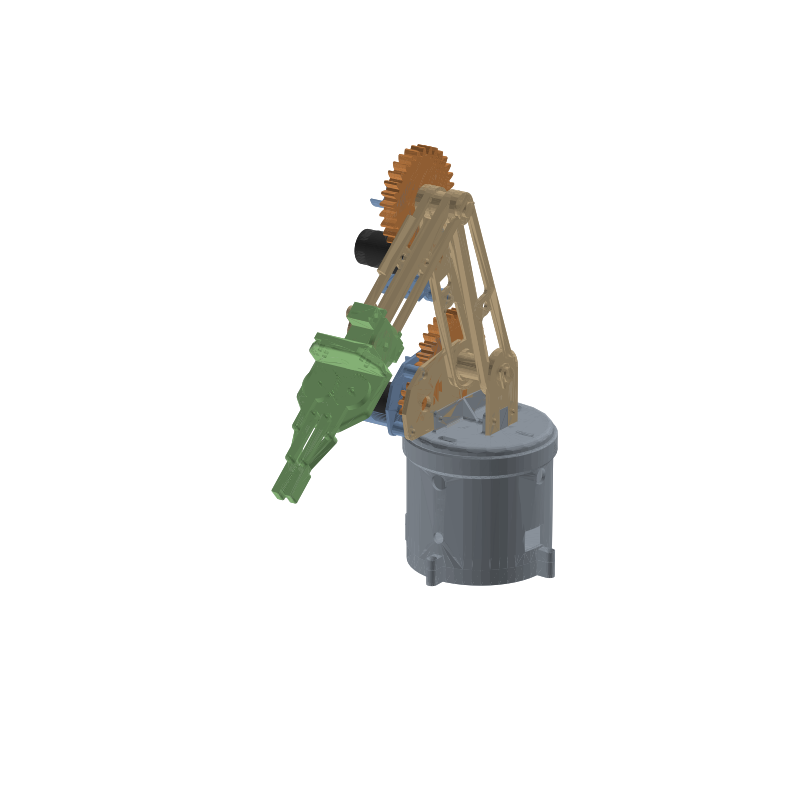

# Ensamblaje del brazo completo

Base (Ignacio) + brazo (Vasil) + gripper (Rapha), con las piezas finales de `../IMPRIMIR/` y los motores
comprados: **JGB37-520B de 12 V y 45 RPM con encoder**. Las piezas de Vasil y de Ignacio **no se han tocado** en sus
carpetas: lo que se ha cambiado son copias que están aquí.

## Archivos

| Archivo | Qué es |
|---|---|
| `ensamblaje_brazo.stl` | Las 34 piezas montadas en un solo STL, en mm. Es el que hay que importar en Solid Edge |
| `motores_JGB37_referencia.stl` | Los 3 motores (con encoder, reductora de 26,5 mm), colocados. **No se imprimen** |
| `piezas_colocadas/` | Cada pieza por separado y ya colocada, por si se quieren importar una a una |
| `transformaciones.json` | Dónde va cada pieza: matriz 4×4 desde su STL de origen |
| `imagenes/` | Vistas del brazo |

Marco: origen en el eje de giro de la base, a la altura del escalón de `BASE_TAPA_INF`; Y hacia arriba; X es la
dirección de los ejes del hombro y del codo. Pose: la del brazo BR3E original (brazo inclinado 19° hacia delante,
codo a ~70°, base a 0°).

## Cómo se mueve cada articulación

| Articulación | Motor | Transmisión | Posición |
|---|---|---|---|
| Base | JGB37 bajo el techo de la torre de `BASE_TAPA_INF`, atornillado de cara | Directa: `Pieza_Eje_Giro_Base` en el eje, unida a `BASE_TAPA_SUP` con un M3 | Finales de carrera |
| Hombro | JGB37 en la cuna de `Shield 1`, atornillado de cara | Piñón de 10 + corona de 30 (módulo 3, 60 mm entre ejes): 3:1 | Potenciómetro en `Eje Parte 1` |
| Codo | JGB37 en la parte plana de `Shield 2`, atornillado de cara | La misma pareja de engranajes: 3:1. La corona va en los planos de `Eje Parte 2` | Potenciómetro en `Eje Parte 2` |
| Pinza | Servo MG90S | Engranajes y paralelogramo del gripper | — |

## Los motores: JGB37-520B, 12 V, 45 RPM, con encoder

Cotas de la ficha del vendedor (son de referencia; medid uno antes de montar):

| | |
|---|---|
| Reductora | Ø37 × 26,5 mm (versión de 45 RPM, reducción 1:131) |
| Motor + encoder | Ø32–33 × 22,7 + 11,75 mm, y detrás el conector de 6 pines (~7 mm) con los cables |
| Eje | Ø6 en D (plano a 5,5), ~15,5 mm, a **7 mm** del centro de la reductora |
| Resalte alrededor del eje | **Ø12 × 6 mm** |
| Tornillos de la cara | 6 × M3 en un círculo de Ø31, con **solo 4 mm de rosca** |
| Cables | 2 del motor (al controlador), 2 de alimentación del encoder (3,3–5 V y GND) y 2 señales A/B. Si no usáis los encoders, basta con los 2 del motor |

**Par.** A 12 V, la versión de 45 RPM da ~2,7 kg·cm nominales (10,8 de bloqueo). Lo que necesita cada articulación,
estimado con PLA, brazo horizontal y estirado y 100 g en la pinza:

| Articulación | Par en la articulación | Par necesario en el motor | Con 45 RPM |
|---|---|---|---|
| Base | Solo rozamiento | Poco | **Bien.** Gira a ~45 RPM sin carga: limitad el PWM en el código |
| Codo | ~6 kg·cm | ~2,5 kg·cm (3:1) | **Justo.** Vale si la pinza no carga más de ~100 g |
| Hombro | ~14 kg·cm | ~6 kg·cm (3:1) | **No llega con el brazo estirado.** Da ~8 kg·cm en la articulación: sostiene el brazo cerca de la vertical, pero se para o cae al inclinarlo estirado más de ~35° |

Si el hombro se queda corto, hay dos soluciones. La primera es cambiar solo ese motor por el de **12 RPM**
(9,1 kg·cm): es el mismo motor con una reductora de 29 mm, entra en la misma cuna y ya está comprobado. La segunda
es un muelle o un contrapeso que compense el peso del brazo. Sin corriente, la reductora deja caer el brazo poco a
poco: aparcadlo en reposo antes de apagar.

## Qué se ha cambiado respecto a las piezas de Vasil e Ignacio

| # | Problema del diseño original | Solución |
|---|---|---|
| 1 | **El codo no tenía motor.** `Shield 2` no tenía sitio ni tornillos para un JGB37 | Segunda pareja corona 30 + piñón 10, igual que el hombro (confirmado por Vasil). El motor se atornilla a la parte plana de `Shield 2`, con el eje a 60 mm del codo (agujero Ø15 nuevo) |
| 2 | **La base podía volcar.** Con el brazo estirado hace ~1,4 N·m sobre el borde y el peso solo sujeta ~0,6 N·m; `BASE_TAPA_SUP` solo estaba apoyada | `Pieza_Eje_Giro_Base` más alta, con prisionero contra el eje, y un M3 desde arriba que la une a `BASE_TAPA_SUP` |
| 3 | **La cuna del hombro no valía para el JGB37:** Ø35,5 frente a la reductora de Ø37, centrada a 8,1 mm en vez de 7, sin tornillos | `Shield 1` con la cuna a Ø37,6, a 7 mm del eje del piñón, y 6 avellanados M3 en Ø31 |
| 4 | **El resalte Ø12 × 6 del motor** atraviesa la placa del shield y chocaba con el piñón; en la base chocaba con `Pieza_Eje_Giro_Base` | Piñones con un rebaje Ø12,8 × 3 mm. `Pieza_Eje_Giro_Base` 4 mm más corta por abajo |
| 5 | **Encoder:** el conector del motor de la base quedaba a ~6 mm de la mesa | `Base_suplemento_15mm` bajo `BASE_TAPA_INF` (quedan ~21 mm) |
| 6 | **Holgura en los gorrones:** Ø13,5 en agujeros Ø15 (varios mm de juego en la pinza) | Agujeros a Ø14,2 en las dos paletas y en `Brazo Parte 1_1` y `1.1` |
| 7 | `Paleta 1` sin holgura entre el brazo y el clip del hombro (4,50 mm para 4,5) | Rebaje de 0,4 mm donde apoya el clip |
| 8 | Agujero en D del piñón a 6,0 × 5,5, sin holgura para el eje del motor | D a 6,15 × 5,65 |
| 9 | La corona entraba muy justa en el eje (0,06 mm) | Agujero de planos a 8,6 × 13,9 |
| 10 | Una tuerca de `Paleta 2` chocaba con el brazo al inclinarlo hacia delante más de ~55° | Avellanado en `Paleta 2` para meter ese M4 al revés |
| 11 | Los potenciómetros bailaban en el semicasquillo (Ø23 para un cuerpo de Ø16–17) | Manguitos partidos que los centran |
| 12 | `BASE_TAPA_SUP` y los `Shield` no se podían imprimir (pestaña colgando, separadores pegados) | Pestaña aparte con espiga y separadores sueltos |
| 13 | `Eje Parte 3` chocaba con el gripper | No se usa: en la punta va el casquillo del gripper |

## Comprobaciones

- **Interferencias** (con `python scripts/montar_ensamblaje.py`): ninguna entre piezas impresas ni con los motores.
  Solo se tocan los ajustes previstos: el eje de cada motor dentro de su agujero en D.
- **Motores:** el resalte libra el piñón (0,6 mm en el hombro y 2 mm en el codo) y `Pieza_Eje_Giro_Base` (2,3 mm).
  Los tornillos de la cara entran 3–3,5 mm en el motor. Con el suplemento, el conector de la base queda a 21 mm de
  la mesa.
- **Engranajes:** las dos parejas están a 60,0 mm y giran sin tocarse. El piñón del codo queda a 2,8 mm de los
  separadores de `Shield 2`.
- **Recorrido** (de 10 en 10°, sin cables):
  - Hombro: de ~90° hacia atrás (brazo horizontal) a ~80° hacia delante, desde la vertical. Más allá, `Shield 2`
    choca con `Shield 1` hacia delante, y el brazo toca `BASE_TAPA_SUP` hacia atrás. El motor del codo nunca
    choca antes que el propio brazo.
  - Codo: libre salvo al plegarse del todo (menos de ~25° entre brazo y antebrazo).
  - Base: gira libre.
- **Gripper:** sin colisiones con el antebrazo y las mordazas abren de 2,3 a ~92 mm (ver `../GRIPPER/README.md`).
- **Impresión:** todas las piezas de `IMPRIMIR/` son sólidos cerrados.

### Apilado a lo largo del hombro (en mm)

`Shield 1` → 0,65 → corona (13,5) → 0,85 → `Paleta 2` (4,5) → 0,15 → `Brazo Parte 1.1` (7,5) → hueco de 27 →
`Brazo Parte 1_1` (7,5) → 0,05 → `Paleta 1` (4,5, con el rebaje de 0,4) → 0,4 → clip

### Ejes y agujeros

| Eje | Pieza | Ajuste | Holgura radial |
|---|---|---|---|
| Hombro (`Eje Parte 1`) | `Brazo Parte 1_1` y `1.1` | Eje en D 22,4 × 13,5 en agujero en D 23,4 × 14,4 | 0,21–0,23 mm |
| | `Paleta 1` y `Paleta 2` | Gorrón Ø13,5 en agujero Ø14,2 (aquí gira) | 0,35 mm |
| | Corona | Planos 13,4 × 8,2 en agujero 13,9 × 8,6 | 0,2 mm |
| Codo (`Eje Parte 2`) | `Brazo Parte 2_1` y `2.2_4` | Eje en D en agujero en D | 0,20–0,23 mm |
| | `Brazo Parte 1_1` y `1.1` | Gorrón Ø13,4–13,5 en agujero Ø14,2 (aquí gira) | 0,35–0,4 mm |
| | Corona | Igual que en el hombro | 0,2 mm |
| Motores | Piñones y `Pieza_Eje_Giro_Base` | Eje Ø6 en D 5,5 en agujero en D 6,15 × 5,65 | 0,075 mm |
| Base | `BASE_TAPA_SUP` en `BASE_TAPA_INF` | Faldón Ø133,4 en alojamiento Ø135 | 0,8 mm |

## Notas
- Los STL de `Arm_Vasil/Brazo_modificado_STL` y de `Base_Ignacio` están en **pulgadas** (la opción por defecto de
  Solid Edge). Los scripts los pasan a mm; los de `IMPRIMIR/` ya están en mm.
- Si Vasil o Ignacio cambian una pieza, se regenera todo con `python scripts/generar_todo.py`. Si cambia la forma de
  los agujeros o de los ejes, hay que revisar su colocación en `transformaciones.json`.
