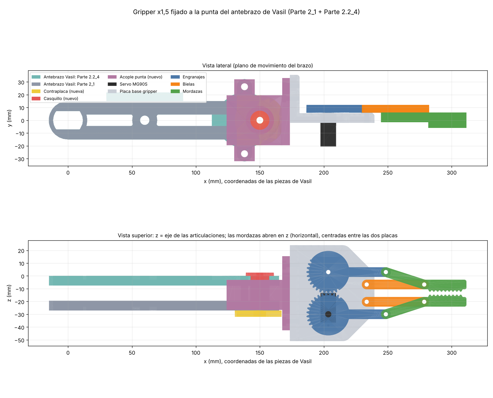

# Gripper: pinza con servo MG90S, escala ×1,5

Pinza de mordazas paralelas accionada por un servo **MG90S**, fijada **sin grado de libertad** a la punta del
antebrazo de Vasil, que está formado por **dos placas paralelas**: `Brazo Parte 2_1` y `Brazo Parte 2.2_4`.
Todo está a **escala ×1,5**, salvo lo que encaja con piezas compradas (servo y tornillos), que está a tamaño real.
Las piezas para imprimir están en [`../IMPRIMIR/3_gripper/`](../IMPRIMIR/3_gripper/).

## Carpetas

| Carpeta | Contenido |
|---|---|
| `solid_edge/` | Ensamblaje de Solid Edge del gripper sobre las dos placas del antebrazo (`.asm`, `.par` y el STEP de partida) |
| `comprobacion/` | Las piezas colocadas sobre las placas de Vasil (`ASM_*`) y las dos placas en mm (`REF_*`) |
| `original/` | STL de partida de la pinza (SuperbTech) |
| `imagenes/` | Vistas del montaje |

## Interfaz con el antebrazo de Vasil

Coordenadas propias de las piezas de Vasil, en mm (codo en x = 0, punta en x = 150; z es el eje de las articulaciones):

| | Placa A: `Brazo Parte 2_1` | Placa B: `Brazo Parte 2.2_4` |
|---|---|---|
| Grosor | 7,5 mm (z de −27 a −19,5) | 7,5 mm (z de −7,5 a 0) |
| Punta (x = 150) | agujero Ø15 + avellanado Ø24 × 4,5 por la cara que mira a B | agujero Ø15 + avellanado Ø24 × 4,5 por la cara que mira a A |
| Extra | — | dos orejetas con agujero Ø6 en (138, ±26,2), de 3 mm (z de −3 a 0) |

Entre las dos placas hay un **hueco de 12 mm** (z de −19,5 a −7,5), que es la cota que define el grosor del bloque
central del acople. `scripts/forearm_ref.py` comprueba las cotas de la punta cada vez que se regenera.

## El acople

- **Bloque central** de 11,7 mm que entra en el hueco entre las dos placas (0,15 mm de holgura por cara).
- **Labios** que abrazan los cantos de las dos placas y hacen tope con el extremo redondo. Impiden el giro y
  centran el acople.
- **Alas** bajo las dos orejetas de la placa B, atornilladas con M5 por los agujeros Ø6. Bloquean el giro alrededor
  del eje de la punta.
- **Casquillo con valona** que rellena los agujeros Ø15 de las dos placas y del bloque. Un **tornillo M5** lo
  atraviesa todo y aprieta contra la **contraplaca** de debajo de la placa A.
- **Brida** con 4 × M3 para la pared del gripper. El gripper queda alineado con el antebrazo, centrado entre las
  dos placas, y las mordazas abren en la dirección del eje de las articulaciones (en horizontal).

El acople se monta **deslizándolo desde la punta** hacia el codo, con el bloque entre las placas y las alas pasando
por debajo de las orejetas. Por eso no puede haber nada entre las placas cerca de la punta (no se usa `Eje Parte 3`).

## Montaje

1. Servo en la placa base con sus tornillos autorroscantes; `gear_right` al estriado con el tornillo del servo.
2. Engranaje izquierdo y bielas a la placa, y mordazas a engranajes y bielas, con M3 × 20 y tuerca autoblocante
   (apretar sin frenar el giro).
3. Pared del gripper a la brida del acople con 4 × M3 × 16 (tuercas en los alojamientos de la parte trasera).
4. Deslizar el acople sobre la punta del antebrazo hasta que haga tope con el extremo redondo.
5. Casquillo desde fuera por la placa B, atravesando bloque y placa A. Contraplaca bajo la placa A.
   Tornillo **M5 × 40** desde la valona del casquillo, con la tuerca en el alojamiento de la contraplaca.
6. Dos tornillos **M5 × 30** por las orejetas de la placa B, con las tuercas en los alojamientos de las alas.

## Datos del mecanismo

- Paralelogramo: manivela y biela de 45 mm entre ejes; las mordazas no giran.
- Engranajes de 32 dientes (sector), 33 mm entre centros, módulo ≈ 1,03.
- Hueco entre mordazas según el giro del servo: 2,3 mm (0°), ~47 mm (30°), ~66 mm (45°), ~80 mm (60°), ~92 mm
  (90°). Sin colisiones de 0° a 90°.
- Fuerza estimada con MG90S (1,8–2,2 kg·cm): ~2–2,4 N por mordaza, para objetos de ~100–150 g.
- Las mordazas acaban ~160 mm más allá del eje de la punta del antebrazo.
- Peso: gripper + acople, casquillo y contraplaca ~90–100 g en PLA (40 % de relleno) + servo 13,4 g + tornillería
  ~20 g. Es lo que tiene que sostener el motor del codo.
- El servo se alimenta a 5 V sin convertidor aparte (decisión de la tutoría): de la salida de 5 V del controlador
  L298N o del pin de 5 V del Arduino, con un condensador de 470 µF junto al conector y masa común.

## Pendiente de confirmar al montar

- El hueco de 12 mm entre las dos placas del antebrazo.
- La altura del estriado del MG90S respecto a sus orejetas se ha tomado del diseño original; si el engranaje queda
  flojo o alto, se corrige con una arandela.

## Base de partida y licencia

| Qué | Origen | Licencia |
|---|---|---|
| Pinza | *Servo Gripper Arm for SG90/MG90S*, SuperbTech – [thing:5149951](https://www.thingiverse.com/thing:5149951) | CC BY (citar al autor) |
