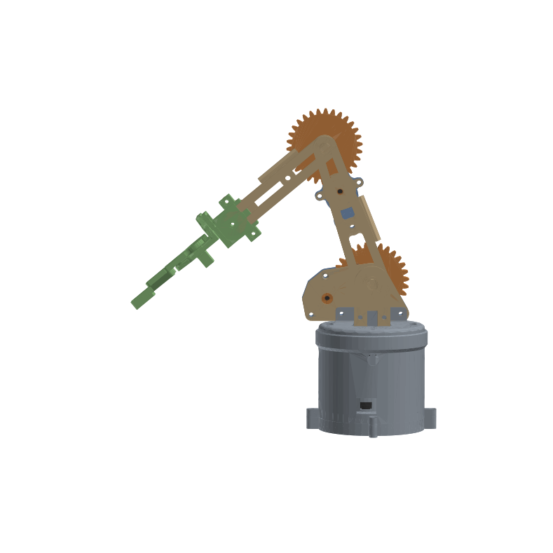

# Gripper_Rapha: brazo robótico completo, listo para imprimir y montar

Carpeta de Rafa en el proyecto del brazo. Tiene el gripper (su parte) y la **versión final de todo el brazo**:
la base de Ignacio y el brazo de Vasil, con los cambios necesarios para que monte, se imprima bien y lleve los
motores comprados (**JGB37-520B de 12 V y 45 RPM con encoder**). Las carpetas `Arm_Vasil` y `Base_Ignacio` no se
modifican: aquí solo hay copias.

## Qué hay en cada carpeta

| Carpeta / archivo | Para qué |
|---|---|
| [`IMPRIMIR/`](IMPRIMIR/README.md) | **Todo lo que hay que imprimir** (31 archivos en `1_base`, `2_brazo` y `3_gripper`), en mm y orientado, con cantidades y ajustes |
| [`TORNILLERIA.md`](TORNILLERIA.md) | Lista de compra de tornillos y dónde va cada uno |
| [`ENSAMBLAJE/`](ENSAMBLAJE/README.md) | El brazo entero montado (STL para Solid Edge), los motores, qué se ha cambiado respecto a las piezas originales y las comprobaciones |
| [`GRIPPER/`](GRIPPER/README.md) | Diseño de la pinza: acople a la punta del antebrazo, Solid Edge, comprobaciones y pinza original |
| [`SOFTWARE/`](SOFTWARE/README.md) | **Programa del Arduino** (control PID de las 3 articulaciones, homing, seguridad, apilar cubos) y herramientas de PC: interfaz gráfica, registro de ensayos y ajuste del PID para el informe, y un simulador |
| [`scripts/`](scripts/README.md) | Código que genera todo lo anterior (`python scripts/generar_todo.py`) |

La guía de montaje paso a paso (con la electrónica) está en el documento compartido del equipo.

## Resumen del brazo

- **Base:** motor directo a `Pieza_Eje_Giro_Base`, que va atornillada a `BASE_TAPA_SUP` para que no vuelque.
  Debajo lleva un suplemento de 15 mm para el encoder del motor.
- **Hombro y codo:** cada uno con un motor atornillado a su shield, un piñón de 10 y una corona de 30 dientes
  (3:1) y un potenciómetro en el eje.
- **Pinza:** servo MG90S a 5 V (con convertidor buck, no desde el Arduino).
- **Con los motores de 45 RPM**, el hombro va justo de par: sostiene el brazo cerca de la vertical, pero no estirado
  en horizontal. Detalles y soluciones en [`ENSAMBLAJE/README.md`](ENSAMBLAJE/README.md#los-motores-jgb37-520b-12-v-45-rpm-con-encoder).
