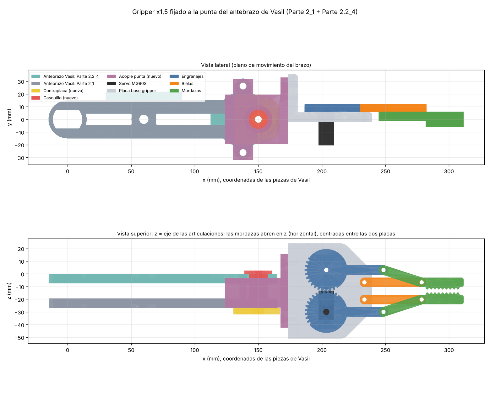

# Gripper (Rapha) – pinza con servo MG90S, escala x1,5

Pinza de mordazas paralelas accionada por un servo **MG90S**, fijada **sin grado de libertad** a la punta
del antebrazo de Vasil, que está formado por **dos placas paralelas**:
`Arm_Vasil/Brazo_modificado/Brazo Parte 2_1` y `Arm_Vasil/Brazo_modificado/Brazo Parte 2.2_4`.
**No se modifica ninguna pieza de Vasil.** Todo está a **escala x1,5**, salvo lo que encaja con piezas
compradas (servo y tornillos), que está a tamaño real.



## Carpetas

| Carpeta | Contenido |
|---|---|
| `imprimir/` | STL listos para laminar (en mm), 1 unidad de cada |
| `solid_edge/Ensamblaje_Gripper_Brazo_Vasil/` | Ensamblaje STEP para Solid Edge: las dos placas del antebrazo de Vasil + acople + casquillo + contraplaca + gripper + servo |
| `comprobacion/` | Los mismos componentes en STL, colocados en las coordenadas de las piezas de Vasil |
| `referencia/` | Las dos placas de Vasil en mm, para comprobar (**no se imprimen aquí**; las imprime Vasil) |
| `original/` | STL de partida de la pinza |
| `scripts/` | Código Python que genera todas las piezas y las comprobaciones |
| `imagenes/` | Vistas del montaje |

## Interfaz con el antebrazo de Vasil

Coordenadas propias de las piezas de Vasil, en mm (codo en x = 0, punta en x = 150; z es el eje de las articulaciones):

| | Placa A: `Brazo Parte 2_1` | Placa B: `Brazo Parte 2.2_4` |
|---|---|---|
| Grosor | 7,5 mm (z de −27 a −19,5) | 7,5 mm (z de −7,5 a 0) |
| Punta (x = 150) | agujero Ø15 + avellanado Ø24 × 4,5 por la cara que mira a B | agujero Ø15 + avellanado Ø24 × 4,5 por la cara que mira a A |
| Extra | — | dos orejetas con agujero Ø6 en (138, ±26,2), de 3 mm (z de −3 a 0) |

Entre las dos placas hay un **hueco de 12 mm** (z de −19,5 a −7,5). Lo confirman las coordenadas de los `.par`
de Vasil y el ensamblaje BR3E original del que parte su brazo, pero **conviene comprobarlo con su montaje**:
es la cota que define el grosor del bloque central del acople. `scripts/forearm_ref.py` comprueba el resto
de cotas cada vez que se regenera.

## El acople

- **Bloque central** de 11,7 mm que entra en el hueco entre las dos placas (0,15 mm de holgura por cara).
- **Labios** que abrazan los cantos de las dos placas y hacen tope con el extremo redondo. Impiden el
  giro y centran el acople.
- **Alas** bajo las dos orejetas de la placa B, atornilladas con M5 por los agujeros Ø6. Bloquean el giro
  alrededor del eje de la punta.
- **Casquillo con valona** que rellena los agujeros Ø15 de las dos placas y del bloque. Un **tornillo M5**
  lo atraviesa todo y aprieta contra la **contraplaca** de debajo de la placa A.
- **Brida** con 4 × M3 para la pared del gripper. El gripper queda alineado con el antebrazo, centrado
  entre las dos placas, y las mordazas abren en la dirección del eje de las articulaciones (en horizontal).

El acople se monta **deslizándolo desde la punta** hacia el codo, con el bloque entre las placas y las alas
pasando por debajo de las orejetas. Por eso no puede haber nada entre las placas cerca de la punta.

## Piezas a imprimir

| Archivo | Qué es | Notas |
|---|---|---|
| `base_plate_x1.5` | Placa base | Hueco del MG90S (12,6 × 23,2 mm) y taladros guía Ø1,8 a tamaño real; pared trasera con 4 × M3 |
| `gear_left_x1.5`, `gear_right_x1.5` | Engranajes-manivela | `gear_right` va al estriado del servo (Ø4,9) con cajeado Ø7 para el tornillo |
| `arm_left_x1.5`, `arm_right_x1.5` | Bielas | |
| `jaw_left_x1.5`, `jaw_right_x1.5` | Mordazas | Mejor agarre con goma, TPU o cinta antideslizante |
| `acople_punta_vasil_x1.5` | Une el gripper a las dos placas | Brida (cara de apoyo del gripper) sobre la cama; soportes en las alas y bajo el bloque. 4 perímetros, ≥40 % relleno |
| `casquillo_punta_x1.5` | Casquillo Ø14,6 con valona Ø22 | Valona sobre la cama, sin soportes |
| `contraplaca_acople_x1.5` | Arandela grande bajo la placa A, con alojamiento de tuerca M5 | Plana, sin soportes |

## Montaje

1. Servo en la placa base con sus tornillos autorroscantes; `gear_right` al estriado con el tornillo del servo.
2. Engranaje izquierdo y bielas a la placa, y mordazas a engranajes y bielas, con M3 × 20 y tuerca autoblocante
   (apretar sin frenar el giro).
3. Pared del gripper a la brida del acople con 4 × M3 × 16 (tuercas en los alojamientos de la parte trasera).
4. Deslizar el acople sobre la punta del antebrazo hasta que haga tope con el extremo redondo.
5. Casquillo desde fuera por la placa B, atravesando bloque y placa A. Contraplaca bajo la placa A.
   Tornillo **M5 × 40** desde la valona del casquillo, con la tuerca en el alojamiento de la contraplaca.
6. Dos tornillos **M5 × 30** por las orejetas de la placa B, con las tuercas en los alojamientos de las alas.

## Tornillería

| Uso | Cant. | Tornillo |
|---|---|---|
| Pivotes en la placa (engranaje izq. + 2 bielas) | 3 | M3 × 20 + tuerca autoblocante |
| Pivotes de las mordazas | 4 | M3 × 20 + tuerca autoblocante |
| Gripper ↔ acople | 4 | M3 × 16 + tuerca M3 |
| Eje de la punta (casquillo + 2 placas + contraplaca) | 1 | M5 × 40 + tuerca M5 + arandela |
| Orejetas de la placa B ↔ alas del acople | 2 | M5 × 30 + tuerca M5 + arandela |
| Servo a la placa | 2 | Los que trae el MG90S |
| Engranaje al eje del servo | 1 | El del horn del MG90S + arandela |

## Datos del mecanismo

- Paralelogramo: manivela y biela de 45 mm entre ejes, las mordazas no giran.
- Engranajes de 32 dientes (sector), 33 mm entre centros, módulo ≈ 1,03.
- Hueco entre mordazas según el giro del servo: 2,3 mm (0°), ~47 mm (30°), ~66 mm (45°), ~80 mm (60°).
  Sin colisiones de 0° a 90°; los dientes siguen engranados hasta ~120°.
- Fuerza estimada con MG90S (1,8–2,2 kg·cm): ~2–2,4 N por mordaza, para objetos de ~100–150 g.
- Las mordazas acaban ~160 mm más allá del eje de la punta del antebrazo.
- Volumen impreso: gripper ~73 cm³ + acople, casquillo y contraplaca ~54 cm³ (con 40 % de relleno, unos
  90–100 g en PLA) + servo 13,4 g + tornillería ~20 g. Este peso lo tiene que sostener el motor del codo.

## Regenerar las piezas

```
pip install trimesh manifold3d shapely scipy rtree olefile
python scripts/run_all.py            # rehace imprimir/ y comprobacion/ y pasa las comprobaciones
python scripts/run_all.py --step     # además el STEP del ensamblaje (pip install cadquery-ocp)
```

`run_all.py` lee las dos placas de `../Arm_Vasil/Brazo_modificado_STL/` (o, si falta el STL, del `.par` de
`Brazo_modificado`), solo lectura, y comprueba que la punta sigue igual; si Vasil la cambia, avisa.
Las cotas del acople están al principio de `scripts/build_mount_vasil.py`.

> Los STL de `Arm_Vasil/Brazo_modificado_STL` están exportados en **pulgadas** (opción por defecto de Solid Edge).
> Los scripts lo detectan, pero **al laminarlos hay que escalarlos ×25,4** o reexportarlos en mm.

## Base de partida y licencias

| Qué | Origen | Licencia |
|---|---|---|
| Pinza | *Servo Gripper Arm for SG90/MG90S*, SuperbTech – [thing:5149951](https://www.thingiverse.com/thing:5149951) | CC BY (citar al autor) |

## Pendiente de confirmar al montar

- Hueco de 12 mm entre las dos placas del antebrazo (ver arriba).
- Que no vaya nada entre las placas en la punta, ni ningún motor en las orejetas de la placa B
  (en el brazo de 3 ejes no hay motor de muñeca).
- La altura del estriado del MG90S respecto a sus orejetas se ha tomado del diseño original; si el engranaje
  queda flojo o alto, se corrige con una arandela.
