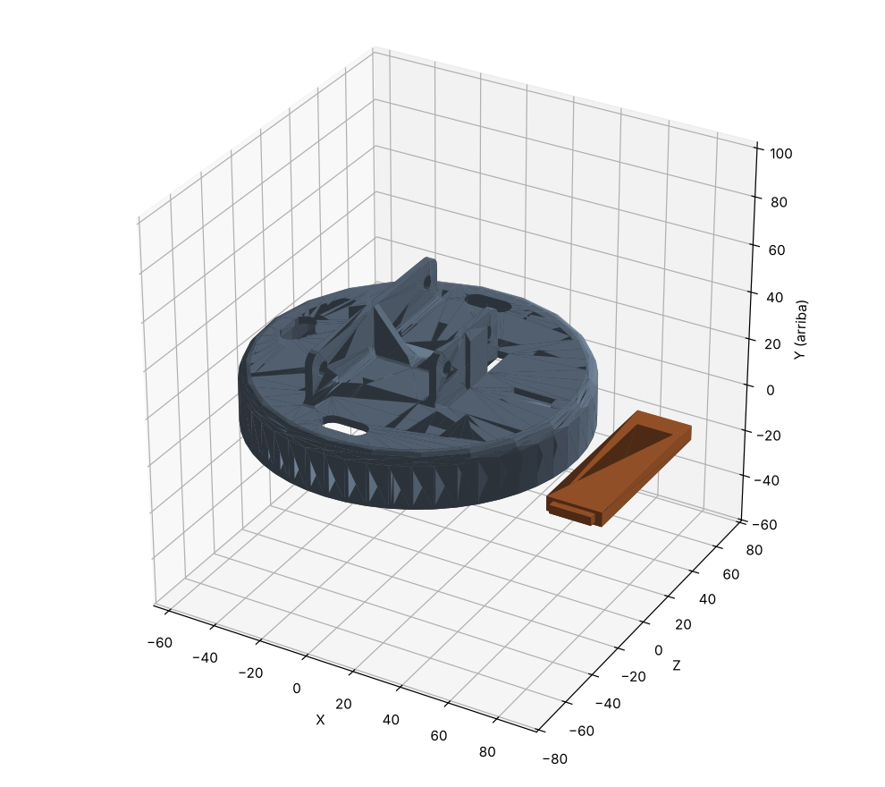

# BASE_TAPA_SUP en versión imprimible

Copia modificada de `Base_Ignacio/BASE_TAPA_SUP` (el original **no se toca**), en **mm**.

El original no se puede apoyar plano en la cama, por dos motivos:
- la pestaña que cuelga bajo el disco baja 50 mm por debajo del faldón;
- el cubo central está 0,5 mm más bajo que el faldón.

## Cambios

1. **La pestaña va aparte** (`BASE_TAPA_SUP_pestana.stl`). Se imprime tumbada y sin soportes. Tiene una espiga de
   17 × 3,5 mm que entra en una mortaja pasante del disco (con 0,2 mm de holgura por lado) y se pega. Una vez
   pegada, queda exactamente donde estaba.
2. **El cubo central se recorta 0,5 mm** para que quede a ras del faldón. El hueco de `Pieza_Eje_Giro_Base`
   pierde solo esos 0,5 mm de profundidad.

Todo lo demás queda igual: el faldón que entra en `BASE_TAPA_INF`, el disco, las ranuras y los agujeros de las
paletas y los pasos de cables. En el ensamblaje completo no choca con nada.

## Cómo imprimir

| Archivo | Cómo ponerlo | Notas |
|---|---|---|
| `BASE_TAPA_SUP_imprimible.stl` | Tal como está: faldón y cubo en la cama | **Soportes solo desde la cama** (en árbol u orgánicos) bajo el disco, que queda a 19,5 mm de altura. Se quitan desde abajo, porque la pieza está abierta. 20–25 % de relleno, 3 perímetros |
| `BASE_TAPA_SUP_pestana.stl` | Tumbada, tal como está | Sin soportes, 100 % de relleno (es pequeña y aguanta los golpes del tope) |

## Montaje

1. Prueba la espiga en la mortaja sin pegamento. Si entra justa, lija un poco la espiga.
2. Pega la pestaña por debajo del disco con **epoxi** (o cianoacrilato espeso), apretando el hombro de la pestaña
   contra el disco. Si sobresale algo de la espiga por arriba, lija hasta dejarla a ras.

> La pestaña toca con `BASE_TAPA_INF` cuando la base gira unos ±90° (hasta ±75° está libre), así que hace de
> tope o de actuador de final de carrera. Conviene limitar el giro por software antes de llegar a ese punto,
> para que no reciba golpes del motor.

Para regenerarlo: `python scripts/build_base_sup_imprimible.py ../Base_Ignacio/BASE_TAPA_SUP.stl base_sup_imprimible`
(salen también en `comprobacion/` las dos piezas en la posición de montaje).
