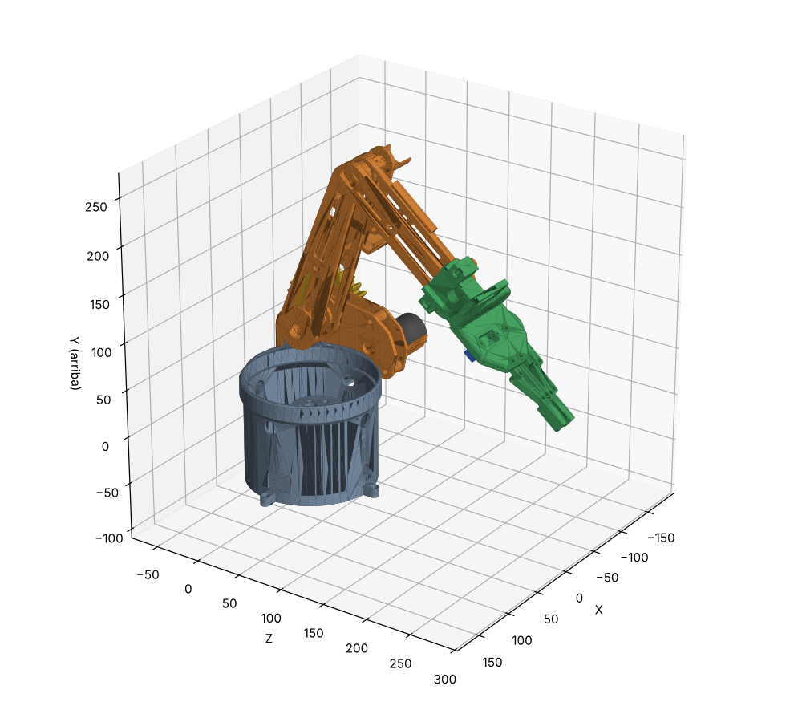

# Revisión del brazo completo

Revisión del 21/10/2026 de todo el repositorio montado junto: base (Ignacio), brazo (Vasil) y gripper (Rapha).
**No se ha modificado ninguna pieza de Vasil ni de Ignacio**; aquí solo hay copias colocadas y comprobaciones.



## Resumen

Las piezas impresas encajan entre sí: no hay ninguna interferencia real y los ejes entran en sus agujeros
con holgura. Antes de imprimir conviene resolver con Vasil estos puntos:

1. **Motor del codo**: `Shield 2` no tiene sitio para un JGB37-520. Es lo más importante.
2. **Cuna del motor del hombro** (`Shield 1`): mide Ø35,5 por dentro, que es el diámetro del motor, pero la reductora
   del JGB37 es Ø37. Sobran 0,75 mm por lado en los primeros 22 mm.
3. **Paleta 1** queda sin holgura axial entre `Brazo Parte 1_1` y el clip del eje: puede frenar el hombro.
4. **No imprimir `Eje Parte 3` para la punta**: lo sustituye el casquillo del gripper.
5. **Hay que imprimir 2 clips** (`Sujetador de eje`), aunque solo haya un STL.

## Archivos

| Archivo | Qué es |
|---|---|
| `ensamblaje_completo.stl` | Las 28 piezas en un único STL, en mm |
| `motores_JGB37_referencia.stl` | Dos JGB37-520 aproximados (hombro y base), solo para ver el hueco; **no se imprimen** |
| `piezas_colocadas/` | Cada pieza por separado y ya colocada, por si se quieren importar una a una en Solid Edge |
| `transformaciones.json` | Colocación de cada pieza (matriz 4×4 desde su STL del repo) |
| `imagenes/` | Vistas del montaje |

Para regenerarlo después de que alguien cambie una pieza (desde `Gripper_Rapha`):

```
python scripts/montar_ensamblaje.py --comprobar
```

Lee los STL del repo (solo lectura) y vuelve a pasar la comprobación de interferencias.
**Si alguna pieza cambia de forma en los agujeros o ejes, hay que revisar su colocación.**

Marco del ensamblaje: origen en el eje de giro de la base, a la altura del escalón de `BASE_TAPA_INF`; Y hacia
arriba; X es la dirección de los ejes del hombro y del codo.

## Cómo está montado (supuestos)

- **Pose**: la del brazo BR3E original del que parte el diseño. El brazo está inclinado 19° hacia delante y el
  ángulo interior del codo es de unos 70°. La base está a 0°.
- **Brazo**:
  - `Brazo Parte 1_1`, `2_1`, `2.2_4`, los dos ejes y el clip están en las posiciones del BR3E original. Coinciden
    con él a escala ×1,5 con menos de 0,1 mm de error.
  - `Brazo Parte 1.1` va por sus agujeros: el agujero en D en el eje del hombro y el redondo en el del codo.
  - `Shield 2` va atornillado a `Parte 1.1` por sus tres agujeros.
- **Base**:
  - `BASE_TAPA_SUP` se apoya con su faldón en el escalón de `BASE_TAPA_INF`.
  - Las paletas entran en las ranuras de `SUP`, con sus agujeros Ø6 alineados con los de las paredes.
  - `Shield 1` se apoya en `Paleta 2` con sus 4 casquillos.
- **Hombro con engranajes**:
  - La corona va en los planos de `Eje Parte 1`, entre `Paleta 2` y `Shield 1`.
  - El piñón va en el segundo agujero Ø15 de `Paleta 2`/`Shield 1`.
  - La distancia entre ejes es de 59,98 mm, frente a los 60 teóricos (módulo 3 × (30 + 10) / 2).
  - El giro del piñón se ha elegido para que los dientes no se toquen.
- **Codo**: transmisión directa (el extremo de `Eje Parte 2` tiene un agujero en D de Ø6 para el eje del motor).
- **Punta**: el gripper con su acople, casquillo y contraplaca, según `comprobacion/`. **Sin** `Eje Parte 3` ni su clip.

## Resultados

### Interferencias entre piezas (en la pose de montaje)

| Pareja | Resultado |
|---|---|
| Todas las piezas impresas entre sí | **Ninguna interferencia real** |
| `Paleta 1` / clip del hombro | Se solapan 0,05 mm: la paleta no tiene holgura axial (ver punto 3) |
| `Eje Parte 1` / `Brazo Parte 1_1` | El escalón Ø22,4 del eje entra 0,1 mm en la pieza. Está dentro del error de medida: no es un problema |
| Motor del hombro (aprox.) / cuna de `Shield 1` | La reductora Ø37 no cabe en la cuna Ø35,5 (ver punto 2) |
| Motor de la base (aprox.) / `Pieza_Eje_Giro_Base` | El eje del motor entra en el agujero en D. Es el ajuste previsto |
| Gripper y acople / `Brazo Parte 2_1` y `Brazo Parte 2.2_4` | Ninguna interferencia, con 0,15 mm de holgura. Comprobado también con el nuevo `Brazo Parte 2.2_4.stl` que ha subido Vasil |

### Ejes y agujeros

| Eje | Pieza | Ajuste | Holgura radial mínima |
|---|---|---|---|
| Hombro (`Eje Parte 1`) | `Brazo Parte 1_1` y `1.1` | Eje en D 22,4 × 13,5 en agujero en D 23,4 × 14,4 | 0,21–0,23 mm ✔ |
| | `Paleta 1` y `Paleta 2` | Gorrón Ø13,5 en agujero Ø15 (aquí gira) | 0,64 mm (algo holgado; si baila, usar un casquillo o cinta de PTFE) |
| | Corona | Planos 13,4 × 8,2 en agujero 13,8 × 8,5 | 0,06 mm (justo: puede que haya que lijar) |
| | Clip | A presión en la ranura | Contacto, como debe ser ✔ |
| Codo (`Eje Parte 2`) | `Brazo Parte 2_1` y `2.2_4` | Eje en D en agujero en D | 0,20–0,23 mm ✔ |
| | `Brazo Parte 1_1` y `1.1` | Gorrón Ø13,4–13,5 en agujero Ø15 (aquí gira) | 0,63 mm (igual que en el hombro) |
| | Clip | A presión en la ranura | Contacto ✔ |
| Base | `BASE_TAPA_SUP` en `BASE_TAPA_INF` | Faldón Ø133,4 en alojamiento Ø135 | 0,8 mm ✔ |

### Apilado a lo largo del hombro (de un lado al otro, en mm)

`Shield 1` → 0,65 → corona (13,5) → 0,85 → `Paleta 2` (4,5) → 0,15 → `Brazo Parte 1.1` (7,5) → hueco de 27 →
`Brazo Parte 1_1` (7,5) → 0,05 → `Paleta 1` (4,5) → **0** → clip

### Rango de movimiento sin choques

Se ha movido cada articulación por separado, de 10 en 10°, con la otra en la pose de montaje. No se han tenido
en cuenta los cables.

- **Hombro**: desde unos 90° hacia atrás (brazo horizontal) hasta unos 80° hacia delante, medido desde la
  vertical. A partir de ~90° hacia delante, `Shield 2` choca con `Shield 1` y `Paleta 2`. Hacia atrás, a ~100°,
  el brazo toca `BASE_TAPA_SUP`.
- **Codo**: no choca en todo su recorrido salvo al plegarse del todo: con menos de ~25° entre brazo y antebrazo,
  el gripper da contra la base y el hombro.
- **Base**: gira libre.

## Puntos para hablar con Vasil

1. **Motor del codo.** `Shield 2` solo tiene un semicasquillo de Ø23,2 por dentro (Ø27,6 por fuera), centrado en
   el eje del codo y de 34 mm de largo.
   - Un JGB37-520 es Ø37 y tiene el eje descentrado unos 7 mm, así que no cabe ahí.
   - Si el codo lleva un JGB37, hace falta una cuna como la de `Shield 1`: Ø37,5, centrada a 7–8 mm del eje
     del codo y con los agujeros de los tornillos.
   - Si lleva otro motor, hay que comprobar que mide Ø23 como mucho y que tiene el eje centrado.
   - `Eje Parte 2` tiene en el extremo los mismos planos que `Eje Parte 1` (donde va la corona). Si el codo
     también va con engranajes, en el repo falta una segunda corona, un segundo piñón y el soporte del motor
     a 60 mm.
2. **Cuna del motor del hombro.** La cuna de `Shield 1` mide Ø35,5 por dentro en toda su longitud, y la reductora
   del JGB37 es Ø37 (0,75 mm por lado en los primeros 22 mm). Además, su centro está a 8,1 mm del eje del piñón,
   y en las hojas de datos del JGB37 suele ser ~7 mm. Conviene medir el motor que habéis comprado y abrir la cuna
   a Ø37,5 en la zona de la reductora.
3. **Paleta 1 sin holgura.** Entre la cara exterior de `Brazo Parte 1_1` y el clip del eje hay 4,50 mm, justo
   el grosor de `Paleta 1`. El hombro puede quedar frenado. Se arregla dejando 0,3–0,5 mm de juego: por ejemplo,
   imprimiendo `Paleta 1` a 4,2 mm en la zona del agujero, o moviendo la ranura del clip en `Eje Parte 1`.
4. **Punta del antebrazo.** `Eje Parte 3` y su clip no se usan con el gripper: chocarían con el casquillo
   (3.000 mm³) y con el acople. El casquillo del gripper hace de eje en la punta.
5. **Cantidades.**
   - `Sujetador de eje`: **2** (hombro y codo).
   - Corona y piñón: 1 de cada (solo el hombro).
   - El resto de piezas de Vasil: 1 de cada.
6. **Unidades.** Todos los STL de `Arm_Vasil/Brazo_modificado_STL` y de `Base_Ignacio` están en **pulgadas**
   (la opción por defecto de Solid Edge). Al laminar hay que escalarlos ×25,4, o reexportarlos en mm.
7. **Repo.** `Brazo Parte 2.2_4.stl` es nuevo y aún no está en el repo, y `Brazo Parte 2.2_4.par` tiene cambios
   sin subir. Con esa versión la punta no cambia y el acople del gripper sigue encajando.

## Lista de piezas del ensamblaje

| Quién | Pieza | Cant. |
|---|---|---|
| Ignacio | `BASE_TAPA_INF`, `BASE_TAPA_SUP`, `Pieza_Eje_Giro_Base` | 1 de cada |
| Vasil | `Base Tapa Superior - Paleta 1`, `Paleta 2`, `Shield 1`, `Shield 2` | 1 de cada |
| Vasil | `Brazo Parte 1_1`, `Brazo Parte 1.1 2.0`, `Brazo Parte 2_1`, `Brazo Parte 2.2_4` | 1 de cada |
| Vasil | `Eje Parte 1 - 2.0`, `Eje Parte 2 - 2.0` | 1 de cada |
| Vasil | `Sujetador de eje` | **2** |
| Vasil | `Corona - 30 dientes`, `Piñon - 10 dientes` | 1 de cada |
| Vasil | `Eje Parte 3` | **0** (lo sustituye el casquillo del gripper) |
| Rapha | Gripper (`imprimir/`: placa base, 2 engranajes, 2 bielas, 2 mordazas) + acople, casquillo y contraplaca | 1 de cada |
| Comprados | JGB37-520 (base y hombro; el del codo, pendiente del punto 1), MG90S (gripper) | |
