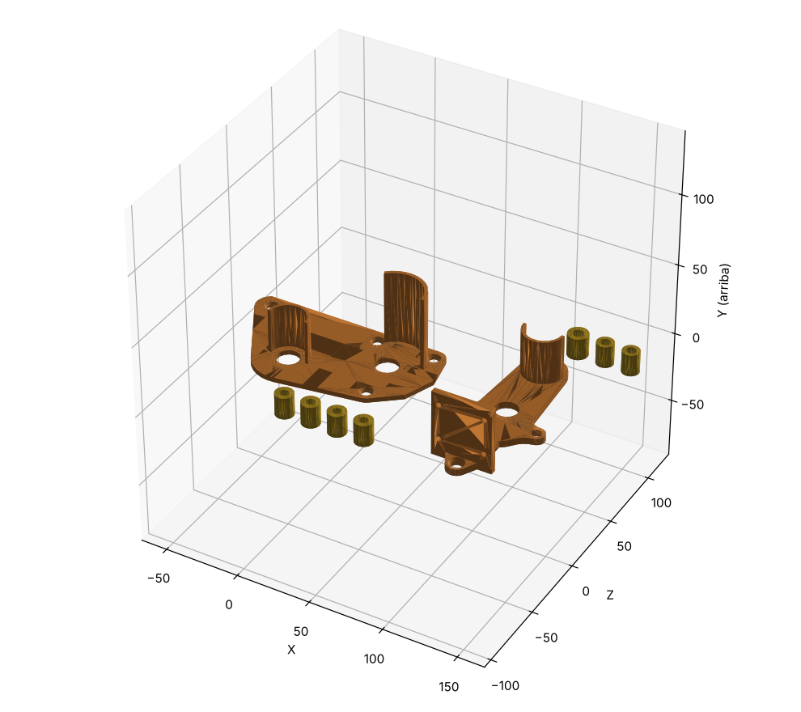

# Shield 1 y Shield 2 en versión imprimible

Copias modificadas de `Arm_Vasil/Brazo_modificado_STL/Shield 1 - 2.0_1` y `Shield 2 - 2.0_1` (los originales
**no se tocan**), en **mm**.

En los originales hay piezas a los dos lados de la placa, así que ninguna cara queda plana para apoyarla en la
cama:
- por un lado, los casquillos separadores;
- por el otro, las cunas del motor y la pared de `Shield 2`.

## Cambio

Los **casquillos separadores van aparte**, como tubos sueltos. Van entre el Shield y la pieza de al lado, y los
aprieta el mismo tornillo que los atraviesa, así que no hace falta pegarlos.

Sin los casquillos, la placa se imprime con esa cara sobre la cama. Las cunas y la pared quedan hacia arriba como
paredes verticales, así que **no necesitan soportes**.

Lo demás no cambia: medidas, agujeros, cunas y alturas son las del original. Placa y separadores juntos dan el
mismo volumen que la pieza original.

## Qué imprimir

| Archivo | Cant. | Cómo ponerlo | Notas |
|---|---|---|---|
| `Shield_1_imprimible.stl` | 1 | Tal como está: placa en la cama, cunas hacia arriba | Sin soportes. 30 % de relleno, 4 perímetros |
| `Shield_1_separadores_x4.stl` | 1 archivo (4 tubos) | De pie | Ø12 × 15 mm con agujero Ø6. Van entre `Shield 1` y `Paleta 2`. 100 % de relleno |
| `Shield_2_imprimible.stl` | 1 | Tal como está: placa en la cama, cuna y pared hacia arriba | Sin soportes. Los dos agujeros pequeños de la pared salen como puentes cortos. 30 % de relleno, 4 perímetros |
| `Shield_2_separadores_x3.stl` | 1 archivo (3 tubos) | De pie | 1 central (Ø13,5, agujero Ø7,5) y 2 laterales (Ø11,2, agujero Ø6,7), todos de 15 mm. Van entre `Shield 2` y `Brazo Parte 1.1`. 100 % de relleno |

## Montaje

Pasa el tornillo por el Shield, pon el separador y atornilla a la pieza de al lado. Para que no se caigan
mientras montas, puedes ponerles una gota de pegamento contra el Shield. En `comprobacion/` están las piezas en
su posición de montaje.

> **Sigue pendiente con Vasil** (no se ha cambiado nada de esto): la cuna de `Shield 1` mide Ø35,5 por dentro y
> la reductora del JGB37 es Ø37; y `Shield 2` no tiene sitio para un JGB37 en el codo. Ver
> `ensamblaje_completo/REVISION_ENSAMBLAJE.md`.

Para regenerarlo: `python scripts/build_shields_imprimibles.py ../Arm_Vasil/Brazo_modificado_STL shields_imprimibles`
